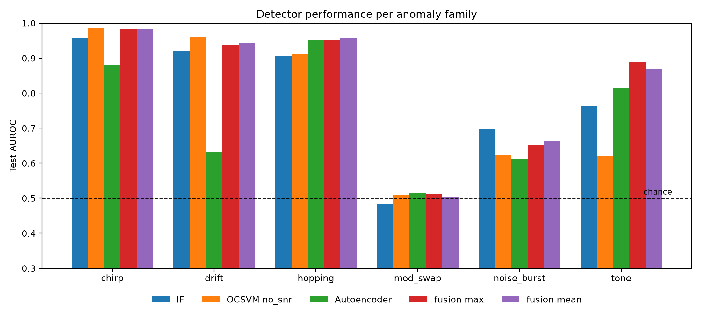
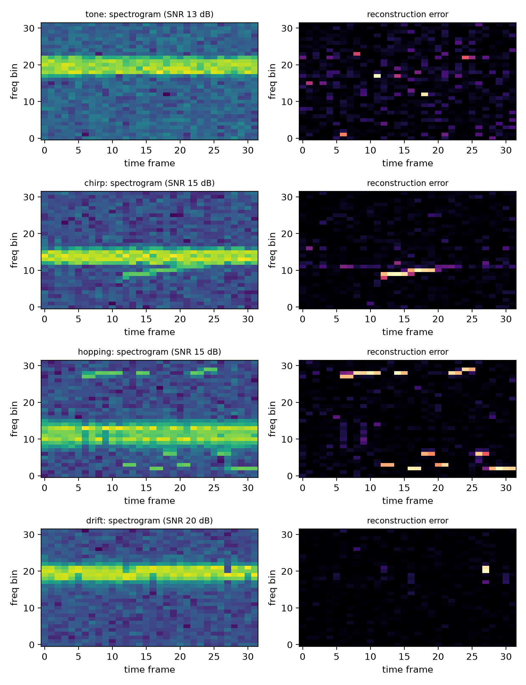
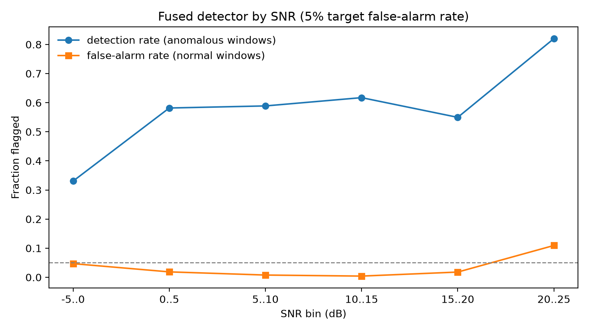

# RF Spectrum Anomaly Detection

**Core question:** can a detector trained only on normal RF activity flag unseen signal types under changing noise and frequency offsets, at a fixed low false-alarm rate?

All results use **synthetic data only**. No real recordings were tested.

## Pipeline

```
Simulator (BPSK / QPSK / 16-QAM / FSK + impairments + anomalies)
   -> windows (4096 samples, hop 2048)
   -> features (13 values) and log-spectrogram (32 x 32)
   -> detectors (Isolation Forest, One-Class SVM, autoencoders)
   -> score fusion
   -> threshold set on validation normals only
   -> per-family and per-SNR evaluation
```

## Data

- **Normal:** BPSK, QPSK, 16-QAM and FSK with pulse shaping, random carrier offset, SNR from -5 to 25 dB.
- **Six anomaly families:** tone, chirp, frequency hopping, drift, noise burst, modulation swap (`mod_swap`).
- **Splits:** train is normal only. Validation has normal plus noise_burst and tone (used for tuning only). Test has all six families, so chirp, drift, hopping and mod_swap are never used for tuning.
- Windows with partial anomaly overlap (under 50%) are dropped as ambiguous.
- Sizes: 4,500 train, 2,051 validation and 4,650 test windows after dropping ambiguous ones. Each recording gives 15 windows.

## Evaluation rules

- Thresholds are set on **validation normal windows only** (1% or 5% false-alarm rate), never on test data.
- All detectors are compared at the **same false-alarm rate**, together with AUROC and AUPRC.
- Anomalies are selected with `y == 1`, not by the family label, because the family label belongs to the whole recording.

## Detectors

| Detector | Input | Notes |
|---|---|---|
| Energy detector | window power | baseline |
| Peak-to-median | PSD peak vs median bin | baseline |
| Isolation Forest | 13 features | trained on normal windows only |
| One-Class SVM | 10 features (no SNR-like ones) | RBF kernel, nu = 0.05 |
| Spectrogram autoencoder | 32x32 log-spectrogram | scikit-learn, per-window dB normalisation |
| Conv autoencoder | 32x32 log-spectrogram | PyTorch, mean-error score |
| Fusion | the three score streams | scores rescaled on validation normals, then averaged |

## Results (test set)

AUROC, mean over 5 seeds (std 0.002 to 0.015 for the seeded models, One-Class SVM has no randomness):

| Detector | chirp | drift | hopping | mod_swap | noise_burst | tone |
|---|---|---|---|---|---|---|
| Energy detector (1 run) | 0.688 | 0.475 | 0.696 | 0.504 | 0.679 | 0.720 |
| Isolation Forest | 0.954 | 0.918 | 0.905 | 0.477 | 0.681 | 0.771 |
| One-Class SVM | 0.985 | 0.960 | 0.911 | 0.509 | 0.625 | 0.621 |
| Spectrogram AE | 0.877 | 0.631 | 0.951 | 0.515 | 0.609 | 0.813 |
| Conv AE (PyTorch) | 0.929 | 0.742 | 0.929 | 0.477 | 0.575 | 0.850 |
| Fusion (IF + OCSVM + AE) | 0.983 | 0.943 | 0.958 | 0.502 | 0.660 | 0.869 |
| Fusion + Conv AE | 0.981 | 0.932 | 0.960 | 0.492 | 0.648 | 0.887 |

Per-window detection rate at a 5% false-alarm target (fusion): chirp 0.93, drift 0.78, hopping 0.83, tone 0.64, noise_burst 0.25, mod_swap 0.05. The energy detector stays under 0.10 on every family. Measured test false-alarm rates were 0.03 to 0.05 against the 5% target.



### Findings

- **The baselines fail because they track SNR.** The energy detector flags only the lowest-SNR windows, and peak-to-median flags only the highest-SNR ones.
- **No single detector wins.** One-Class SVM is best on chirp and drift, the autoencoders on hopping and tone, Isolation Forest on noise_burst. Fusion is within about 0.02 of the best on most families and better on tone, but loses to One-Class SVM alone on chirp and drift.
- **The conv autoencoder did not improve fusion overall.** It helped tone (0.887 vs 0.869) and hurt drift (0.932 vs 0.943). Bottleneck size (4, 16, 64) and longer training (150 epochs) made no real difference. The max-pooled error score was worse than the mean score.
- **Error heatmaps:** reconstruction error lights up on chirp sweeps and hop positions, but not on tone or drift, which look like a normal signal moved around.



### Detection latency (fusion, seed 0)

A detected anomaly is usually flagged on its first anomalous window (median 0 windows, about 2 ms of extra delay per window step; a window itself is 4.1 ms). Per-recording detection at 5% per-window false alarms: chirp 1.00, drift 0.98, hopping 0.92, tone 0.86, noise_burst 0.76, mod_swap 0.18. The cost: at 5% per-window false alarms, 24% of normal 15-window recordings raise at least one false alarm (0% at 1%). At 1%: chirp 0.94, drift 0.84, hopping 0.86, tone 0.70, noise_burst 0.60, mod_swap 0.06.



### Distribution shift (SNR)

Trained only on windows with SNR >= 10 dB, the false-alarm rate in the -5 to 5 dB bins rose to 1.00 for Isolation Forest and One-Class SVM, but only to about 0.10 for the spectrogram autoencoder (which removes each window's mean dB level). Training on a mix of SNRs keeps the false-alarm rate roughly even.

### Spectrogram ablations (scikit-learn autoencoder, 3 seeds, test AUROC)

| Setting | chirp | drift | hopping | mod_swap | noise_burst | tone |
|---|---|---|---|---|---|---|
| Baseline (128-sample frames, normalised) | 0.878 | 0.631 | 0.951 | 0.514 | 0.611 | 0.812 |
| No normalisation | 0.905 | 0.708 | 0.907 | 0.472 | 0.587 | 0.835 |
| 64-sample frames | 0.853 | 0.635 | 0.904 | 0.456 | 0.565 | 0.806 |
| 256-sample frames | 0.885 | 0.634 | 0.956 | 0.505 | 0.604 | 0.847 |

Removing normalisation helps drift, chirp and tone but hurts hopping, and makes the false-alarm rate in the 20 to 25 dB bin worse (0.17 vs 0.13). Finer time resolution did not help; finer frequency resolution helped tone. Window length was not tested.

## Limitations

- **mod_swap is not detected** (AUROC about 0.5). The 13 features and the spectrogram contain power structure only, and the normal data already contains all the modulations.
- Part of the detection at high SNR reflects unusual clean windows, so the per-SNR false-alarm rate is not flat (about 0.10 to 0.13 at 20 to 25 dB).
- Seeds change model initialisation only. The dataset is fixed, so the std does not cover data variance.
- Synthetic data only. Window length and carrier-offset shift were not tested. No real-data check and no dashboard.
- Only 50 recordings per family, so per-recording rates carry roughly +-0.10 uncertainty.

## Project structure

```
rf-anomaly/
├── src/
│   ├── sources/     # simulated recordings
│   ├── signals/     # modulations, impairments, anomalies
│   ├── dsp/         # windowing, features, spectrogram
│   ├── data/        # splits, cached feature loading
│   ├── models/      # classical detectors, autoencoders, fusion
│   └── eval/        # metrics, seed statistics
├── scripts/         # build_dataset.py
├── notebooks/       # 03_baselines.ipynb (all experiments)
├── tests/           # unit tests
└── figures/         # result plots
```

## Reproduce

```bash
pip install numpy scipy scikit-learn matplotlib pytest torch jupyter
python -m pytest tests -v                 # all tests should pass
python scripts/build_dataset.py           # builds data/*.npz (about 400 MB, git-ignored)
# then run notebooks/03_baselines.ipynb from the top (Cells 0 to 15)
```

Use `python scripts/build_dataset.py --small` for a quick test run on about a tenth of the data.